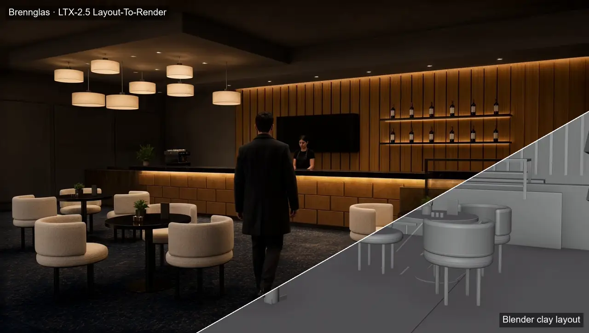

# Brennglas

<p align="center"><b>
<a href="#setup">Setup</a> &nbsp;·&nbsp;
<a href="#layout-to-video">Layout to video</a> &nbsp;·&nbsp;
<a href="#claude-as-your-director">Claude as your director</a> &nbsp;·&nbsp;
<a href="#models">Models and licenses</a> &nbsp;·&nbsp;
<a href="#model-files">Model files</a>
</b></p>

**Ask Claude for a spot. Get a cut clip, rendered on your own GPU.**

[](screenshots/mara.mp4)

*The same woman in five shots: Claude placed a saved character in new scenes, animated and cut them. No training, no face swap.*

[](screenshots/spot.mp4)

*A 16 second spot from a two line request, with logo and end card.*

[](screenshots/layout.mp4)

*A grey Blender layout (bottom right) became the finished shot. Camera and people follow it frame by frame.*

Brennglas is a local web app for open image and video models. ComfyUI renders everything on your GPU, no cloud, no login.
It is also an MCP server, so Claude can direct whole clips for you.

<table>
<tr>
<td width="50%"><br><b>Edit with reference images</b>, before/after slider, edit chains.</td>
<td width="50%"><br><b>Image to video with sound</b>, camera presets and looks.</td>
</tr>
</table>

## What it does

- Text to image and editing with up to 16 reference images.
- Consistent characters and products: save one once, put up to three into any scene.
- Text to video, image to video, first plus last frame, with sound. Camera presets, or exact camera paths with Wan Fun Camera.
- [Layout to video](#layout-to-video): a grey 3D animation sets camera and motion, one rendered frame sets the look.
- Upscaling of images to 8K, and of videos and render sequences to 4K.
- A video editor for cuts, transitions, music, logo and end card.
- An image editor to rework results between generations: layers, blend modes, opacity, brush and eraser, snapping, crop. Save to the gallery or send straight to an edit model.
- A prompt assistant that writes good English prompts from short notes in any language.
- Gallery with search and series, live preview, queue. English and German interface.

## Setup

You need Windows 10 or 11, an NVIDIA GPU (tested with 24 GB) and about 10 GB plus 5 to 50 GB per model.

1. `git clone https://github.com/m-w-marker/brennglas.git` or download the ZIP. Pick a drive with free space, not your user folder.
2. Double click `install.bat`. It sets up Node.js, ComfyUI, optionally ffmpeg, and the models you pick (nothing system wide).
3. Double click `start.bat`. The gallery starts with eight sample images; Remix shows how each was made.

Run `install.bat` again to add models. **Updating:** `git pull` (or unpack the new ZIP over the old folder), then `install.bat` once. Your gallery and settings stay.

<details><summary>Manual setup, and what install.bat adds</summary>

In a Command Prompt with Node.js 22.18 or newer:

```
cd brennglas\app
corepack pnpm install
copy .env.example .env
```

Set `COMFY_DIR` in `app\.env` to your portable ComfyUI folder (the one with `python_embeded`), then get the [model files](#model-files).
Start ComfyUI, run `pnpm dev` in `app` and open http://127.0.0.1:5173.

`install.bat` uses your portable [ComfyUI](https://github.com/comfyanonymous/ComfyUI) 0.45 or newer or downloads it (about 2 GB), adds
ffmpeg ([FFmpeg-Builds](https://github.com/FFmpeg-Builds/FFmpeg-Builds), GPL, about 90 MB) for cutting and video upscaling, and on request
[VideoHelperSuite](https://github.com/Kosinkadink/ComfyUI-VideoHelperSuite) and [WAS Node Suite](https://github.com/WASasquatch/was-node-suite-comfyui)
for render sequences. For gated models it opens the Hugging Face page and asks once for a read token.

</details>

## Layout to video

For 3D artists: block out a shot, keep it grey, get the finished film.

1. Render the viewport animation as MP4 at 24 fps. People are mannequins with a ball head.
2. Render frame 0 of the same camera in your usual renderer. It sets the look.
3. Drop both into the tab "Layout to video" and describe the shot in a sentence.

LTX-2.5 with Lightricks' Layout-To-Render IC-LoRA, ComfyUI core nodes only. Five seconds at 720p take about a minute on 24 GB.
No renderer? Claude can turn the first layout frame into a photo, as in the clip above.

## Claude as your director

[](https://glama.ai/mcp/servers/m-w-marker/brennglas)

With the built-in MCP server Claude plans a shot list, renders and checks start images, animates the shots, redoes weak ones and cuts the clip with music, logo and end card. Everything shows up live in your gallery. Try:

> Make a 15 second spot for our ceramics brand HALDE. Three shots of the blue vase in a calm Japandi living room, golden hour light, our logo in the corner and an end card.

**Connect Claude Desktop:** `install.bat` prints a ready config block at the end. Paste it in Settings → Developer → Edit Config, then restart Claude Desktop completely (also from the tray). Brennglas must be running.<br>
**Claude Code:** open the Brennglas folder, `.mcp.json` registers the server.

<details><summary>Config by hand, tools, other clients</summary>

Replace `<brennglas folder>` with your path, every backslash twice. With your own Node.js 22.18 or newer, `"node"` works as `command`.

```json
{
  "mcpServers": {
    "brennglas": {
      "command": "<brennglas folder>\\app\\runtime\\node\\node.exe",
      "args": ["<brennglas folder>\\app\\mcp\\src\\index.ts"]
    }
  }
}
```

Tools: `generate_media`, `upscale_media` (images up to 8k, videos up to UHD), `wait_for_job`, `get_item`, `cancel_job`, `inspect_image` (full resolution crops), `list_figures`, `create_figure`, `update_figure` and `delete_figure` (characters), `extract_last_frame`, `concat_videos` (cut, transitions, music, logo, end card), `list_models`, `list_gallery`, `delete_item`, `enhance_prompt`. The server also gives Claude a short directing guide.

If the tools do not show up, Settings → Developer shows the log; usually a path has single backslashes or Brennglas is not running.
Other local (stdio) MCP clients such as Codex CLI or LM Studio should work but are not tested. Brennglas only listens on your own computer.

</details>

## Models

Each model has its own license; Brennglas shows it before first use. Short summary, not legal advice.

| Model | Use | License | Commercial use |
|---|---|---|---|
| Qwen-Image-2.1 Turbo | image, edit | [Qwen Research](https://huggingface.co/Qwen/Qwen-Image-2.1-Turbo) | No. Research and evaluation only. |
| FLUX 3 Image Klein | image, edit | [FLUX Kommunity](https://huggingface.co/black-forest-labs/flux-3-image-klein) | Below USD 5M yearly revenue, with content filters or output review. |
| Krea 2 Turbo | image | [Krea 2 Community](https://huggingface.co/krea/Krea-2-Turbo) | Below USD 1M yearly revenue, with content filters or an equivalent review. |
| Z-Image Turbo | image | [Apache 2.0](https://huggingface.co/Tongyi-MAI/Z-Image-Turbo) | Yes. |
| LTX-2.5 22B, Layout-To-Render | video with sound, layout to video | [LTX-2.x Community](https://github.com/Lightricks/LTX-2/blob/main/LICENSE-2_x) | Below USD 10M yearly revenue. |
| Wan 2.2 Fun Camera 14B | video with camera path | [Apache 2.0](https://huggingface.co/alibaba-pai/Wan2.2-Fun-A14B-Control-Camera) | Yes. |
| SeedVR2 7B | upscaling | [Apache 2.0](https://huggingface.co/ByteDance-Seed/SeedVR2-7B) | Yes. |
| Gemma 4 E2B, Qwen 3.5 9B | prompt assistant | [Apache 2.0](https://huggingface.co/Qwen/Qwen3.5-9B) | Yes. |

Missing a model? [Open an issue](https://github.com/m-w-marker/brennglas/issues).

## Speed and hardware

Times measured on an RTX 3090 at 2 MP (video: the stated size). RTX 3060/4060-class cards are roughly 2 to 3× slower
(community SDXL benchmarks). The app shows these times under the model and, after a few runs, your own times.

Every model also ran on a simulated 12 GB card at about the same speed: ComfyUI keeps the weights in system RAM and streams
them to the GPU. On smaller cards RAM is the limit, not VRAM. For video on 12 GB cards NVIDIA recommends 540p.

<!-- model-speed:start -->
| Model | RTX 3090 | With prompt enhancer | RAM for 12 to 16 GB cards |
|---|---|---|---|
| Z-Image Turbo | image ~10 s | image ~38 s | 32 GB |
| Krea 2 Turbo | image ~35 s | image ~38 s | 32 GB |
| FLUX 3 Image Klein | image ~10 s, edit ~24 s | image ~14 s, edit ~28 s | 32 GB |
| Qwen-Image-2.1 Turbo | image ~9 s, edit ~19 s | image ~26 s, edit ~39 s | 32 GB |
| LTX-2.5 22B | image to video ~57 s (720p, 5 s; 1080p ~2 min) |  | 64 GB |
| Wan 2.2 Fun Camera 14B | image to video ~1.6 min (480p, 5 s; 720p ~5.5 min) |  | 64 GB |
| LTX-2.5 Layout-To-Render | layout to video ~1.7 min (720p, 5 s) |  | 64 GB |
| SeedVR2 7B | upscale ~13 s (image to 4k) |  | 32 GB |
<!-- model-speed:end -->

## Model files

`install.bat` downloads them for you. By hand, put each file into the named folder under `ComfyUI\models`; shared files are needed once.

<!-- model-files:start -->
Gated on Hugging Face: [FLUX 3 Image Klein](https://huggingface.co/black-forest-labs/flux-3-image-klein-comfy), [LTX-2.5 22B](https://huggingface.co/Lightricks/LTX-2.5), [LTX-2.5 Layout-To-Render](https://huggingface.co/Lightricks/LTX-2.5).
Log in, open the model page and accept the license once. Then their links work in your browser.

<details><summary>Z-Image Turbo</summary>

| File | Folder | Purpose |
|---|---|---|
| [z_image_turbo_int8_convrot.safetensors](https://huggingface.co/Comfy-Org/z_image_turbo/resolve/main/split_files/diffusion_models/z_image_turbo_int8_convrot.safetensors) | `diffusion_models` | model |
| [qwen_3_4b_fp8_mixed.safetensors](https://huggingface.co/Comfy-Org/z_image_turbo/resolve/main/split_files/text_encoders/qwen_3_4b_fp8_mixed.safetensors) | `text_encoders` | text encoder, prompt enhancer (image) |
| [ae.safetensors](https://huggingface.co/Comfy-Org/z_image_turbo/resolve/main/split_files/vae/ae.safetensors) | `vae` | VAE |

</details>

<details><summary>Krea 2 Turbo</summary>

| File | Folder | Purpose |
|---|---|---|
| [krea2_turbo_fp8_scaled.safetensors](https://huggingface.co/Comfy-Org/Krea-2/resolve/main/diffusion_models/krea2_turbo_fp8_scaled.safetensors) | `diffusion_models` | model |
| [qwen3vl_4b_fp8_scaled.safetensors](https://huggingface.co/Comfy-Org/Krea-2/resolve/main/text_encoders/qwen3vl_4b_fp8_scaled.safetensors) | `text_encoders` | text encoder, prompt enhancer (image) |
| [qwen_image_vae.safetensors](https://huggingface.co/Comfy-Org/Krea-2/resolve/main/vae/qwen_image_vae.safetensors) | `vae` | VAE |

</details>

<details><summary>FLUX 3 Image Klein</summary>

| File | Folder | Purpose |
|---|---|---|
| [flux3-image-klein-int8-convrot.safetensors](https://huggingface.co/black-forest-labs/flux-3-image-klein-comfy/resolve/main/diffusion_models/flux3-image-klein-int8-convrot.safetensors) | `diffusion_models` | model |
| [qwen3.5_9b_flux3_prompt_upsampler_w4a8.safetensors](https://huggingface.co/black-forest-labs/flux-3-image-klein-comfy/resolve/main/text_encoders/qwen3.5_9b_flux3_prompt_upsampler_w4a8.safetensors) | `text_encoders` | prompt enhancer |
| [qwen3vl_4b_int8_convrot.safetensors](https://huggingface.co/black-forest-labs/flux-3-image-klein-comfy/resolve/main/text_encoders/qwen3vl_4b_int8_convrot.safetensors) | `text_encoders` | text encoder |
| [flux2-vae.safetensors](https://huggingface.co/Comfy-Org/flux2-dev/resolve/main/split_files/vae/flux2-vae.safetensors) | `vae` | VAE |

</details>

<details><summary>Qwen-Image-2.1 Turbo</summary>

| File | Folder | Purpose |
|---|---|---|
| [qwen_image_2.1_turbo_int8_convrot.safetensors](https://huggingface.co/Comfy-Org/Qwen-Image-2.1/resolve/main/diffusion_models/qwen_image_2.1_turbo_int8_convrot.safetensors) | `diffusion_models` | model |
| [qwen3.5_9b_qwen_image_2.1_pe_i2i.int8_convrot.safetensors](https://huggingface.co/Comfy-Org/Qwen-Image-2.1/resolve/main/text_encoders/qwen3.5_9b_qwen_image_2.1_pe_i2i.int8_convrot.safetensors) | `text_encoders` | prompt enhancer (edit) |
| [qwen3.5_9b_qwen_image_2.1_pe_t2i.int8_convrot.safetensors](https://huggingface.co/Comfy-Org/Qwen-Image-2.1/resolve/main/text_encoders/qwen3.5_9b_qwen_image_2.1_pe_t2i.int8_convrot.safetensors) | `text_encoders` | prompt enhancer (image) |
| [qwen3vl_8b_int8_convrot.safetensors](https://huggingface.co/Comfy-Org/Qwen-Image-2.1/resolve/main/text_encoders/qwen3vl_8b_int8_convrot.safetensors) | `text_encoders` | text encoder |
| [qwen_image_2.1_vae_bf16.safetensors](https://huggingface.co/Comfy-Org/Qwen-Image-2.1/resolve/main/vae/qwen_image_2.1_vae_bf16.safetensors) | `vae` | VAE |

</details>

<details><summary>LTX-2.5 22B</summary>

| File | Folder | Purpose |
|---|---|---|
| [ltx-2.5-22b-distilled-transformer-comfy-int8-convrot.safetensors](https://huggingface.co/Lightricks/LTX-2.5/resolve/main/diffusion_models/ltx-2.5-22b-distilled-transformer-comfy-int8-convrot.safetensors) | `diffusion_models` | model |
| [ltx-2.5-latent-spatial-upscaler-x2-bf16-1.0.safetensors](https://huggingface.co/Lightricks/LTX-2.5/resolve/main/latent_upscale_models/ltx-2.5-latent-spatial-upscaler-x2-bf16-1.0.safetensors) | `latent_upscale_models` | latent upscaler |
| [gemma4_e2b_it_int8_convrot.safetensors](https://huggingface.co/Comfy-Org/gemma-4/resolve/main/text_encoders/gemma4_e2b_it_int8_convrot.safetensors) | `text_encoders` | prompt enhancer |
| [gemma4-12b-with-proj-ltx-2.5-comfy-int8-convrot.safetensors](https://huggingface.co/Lightricks/LTX-2.5/resolve/main/text_encoders/gemma4-12b-with-proj-ltx-2.5-comfy-int8-convrot.safetensors) | `text_encoders` | text encoder |
| [ltx-2.5-audio-vae-bf16.safetensors](https://huggingface.co/Lightricks/LTX-2.5/resolve/main/vae/ltx-2.5-audio-vae-bf16.safetensors) | `vae` | VAE |
| [ltx-2.5-video-vae-bf16.safetensors](https://huggingface.co/Lightricks/LTX-2.5/resolve/main/vae/ltx-2.5-video-vae-bf16.safetensors) | `vae` | VAE |

</details>

<details><summary>Wan 2.2 Fun Camera 14B</summary>

| File | Folder | Purpose |
|---|---|---|
| [wan2.2_fun_camera_high_noise_14B_fp8_scaled.safetensors](https://huggingface.co/Comfy-Org/Wan_2.2_ComfyUI_Repackaged/resolve/main/split_files/diffusion_models/wan2.2_fun_camera_high_noise_14B_fp8_scaled.safetensors) | `diffusion_models` | model |
| [wan2.2_fun_camera_low_noise_14B_fp8_scaled.safetensors](https://huggingface.co/Comfy-Org/Wan_2.2_ComfyUI_Repackaged/resolve/main/split_files/diffusion_models/wan2.2_fun_camera_low_noise_14B_fp8_scaled.safetensors) | `diffusion_models` | model |
| [wan2.2_i2v_lightx2v_4steps_lora_v1_high_noise.safetensors](https://huggingface.co/Comfy-Org/Wan_2.2_ComfyUI_Repackaged/resolve/main/split_files/loras/wan2.2_i2v_lightx2v_4steps_lora_v1_high_noise.safetensors) | `loras` | LoRA |
| [wan2.2_i2v_lightx2v_4steps_lora_v1_low_noise.safetensors](https://huggingface.co/Comfy-Org/Wan_2.2_ComfyUI_Repackaged/resolve/main/split_files/loras/wan2.2_i2v_lightx2v_4steps_lora_v1_low_noise.safetensors) | `loras` | LoRA |
| [qwen3.5_9b_w4a8_gptq.safetensors](https://huggingface.co/Comfy-Org/Qwen3.5/resolve/main/text_encoders/qwen3.5_9b_w4a8_gptq.safetensors) | `text_encoders` | prompt enhancer (image to video) |
| [umt5_xxl_fp8_e4m3fn_scaled.safetensors](https://huggingface.co/Comfy-Org/Wan_2.1_ComfyUI_repackaged/resolve/main/split_files/text_encoders/umt5_xxl_fp8_e4m3fn_scaled.safetensors) | `text_encoders` | text encoder |
| [wan_2.1_vae.safetensors](https://huggingface.co/Comfy-Org/Wan_2.2_ComfyUI_Repackaged/resolve/main/split_files/vae/wan_2.1_vae.safetensors) | `vae` | VAE |

</details>

<details><summary>LTX-2.5 Layout-To-Render</summary>

| File | Folder | Purpose |
|---|---|---|
| [ltx-2.5-22b-distilled-transformer-comfy-int8-convrot.safetensors](https://huggingface.co/Lightricks/LTX-2.5/resolve/main/diffusion_models/ltx-2.5-22b-distilled-transformer-comfy-int8-convrot.safetensors) | `diffusion_models` | model |
| [ltx-2.5-latent-spatial-upscaler-x2-bf16-1.0.safetensors](https://huggingface.co/Lightricks/LTX-2.5/resolve/main/latent_upscale_models/ltx-2.5-latent-spatial-upscaler-x2-bf16-1.0.safetensors) | `latent_upscale_models` | latent upscaler |
| [ltx-2.5-22b-ic-lora-layout-to-render-1.0.safetensors](https://huggingface.co/Lightricks/LTX-2.5-22b-IC-LoRA-Layout-To-Render/resolve/main/ltx-2.5-22b-ic-lora-layout-to-render-1.0.safetensors) | `loras` | LoRA |
| [gemma4-12b-with-proj-ltx-2.5-comfy-int8-convrot.safetensors](https://huggingface.co/Lightricks/LTX-2.5/resolve/main/text_encoders/gemma4-12b-with-proj-ltx-2.5-comfy-int8-convrot.safetensors) | `text_encoders` | text encoder |
| [ltx-2.5-video-vae-bf16.safetensors](https://huggingface.co/Lightricks/LTX-2.5/resolve/main/vae/ltx-2.5-video-vae-bf16.safetensors) | `vae` | VAE |

</details>

<details><summary>SeedVR2 7B</summary>

| File | Folder | Purpose |
|---|---|---|
| [seedvr2_7b_int8_convrot.safetensors](https://huggingface.co/Comfy-Org/SeedVR2/resolve/main/diffusion_models/seedvr2_7b_int8_convrot.safetensors) | `diffusion_models` | model |
| [seedvr2_ema_vae_fp16.safetensors](https://huggingface.co/Comfy-Org/SeedVR2/resolve/main/vae/seedvr2_ema_vae_fp16.safetensors) | `vae` | VAE |

</details>

<details><summary>Prompt assistant (Gemma 4 E2B, Qwen 3.5 9B)</summary>

| File | Folder | Purpose |
|---|---|---|
| [gemma4_e2b_it_int8_convrot.safetensors](https://huggingface.co/Comfy-Org/gemma-4/resolve/main/text_encoders/gemma4_e2b_it_int8_convrot.safetensors) | `text_encoders` | language model |
| [qwen3.5_9b_w4a8_gptq.safetensors](https://huggingface.co/Comfy-Org/Qwen3.5/resolve/main/text_encoders/qwen3.5_9b_w4a8_gptq.safetensors) | `text_encoders` | language model |

</details>
<!-- model-files:end -->

## Ideas

A light version over cloud APIs without a strong GPU, 16 GB cards (in the works), remote access: [tell me](https://github.com/m-w-marker/brennglas/issues) what you need.

## License

Brennglas is [AGPL-3.0-only](LICENSE): free to use; if you share a changed version or run it as a service for others, publish your code. The models have their own licenses, see above.
