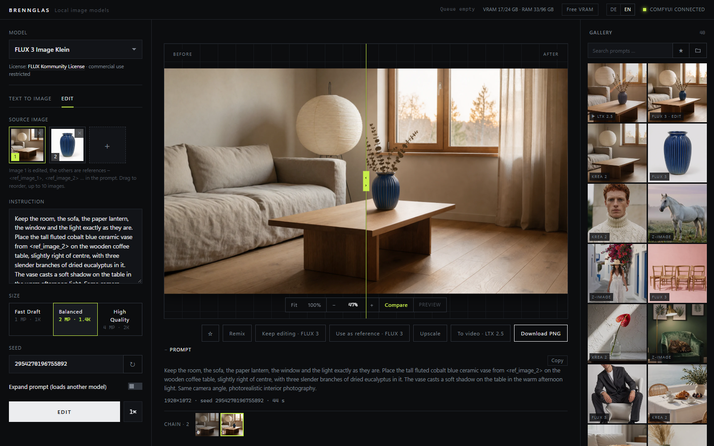
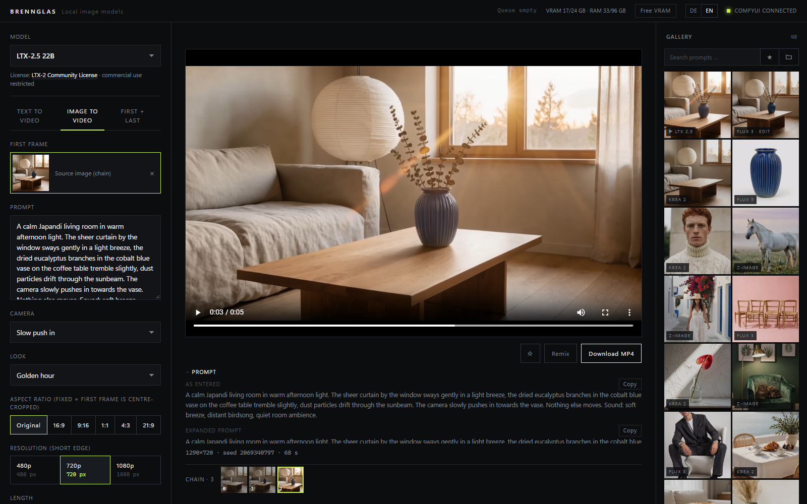
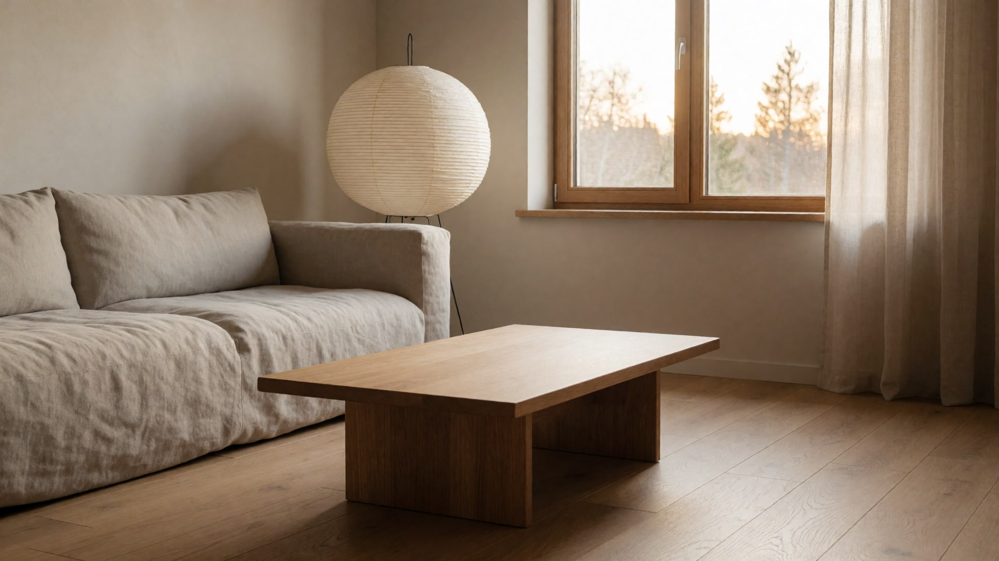
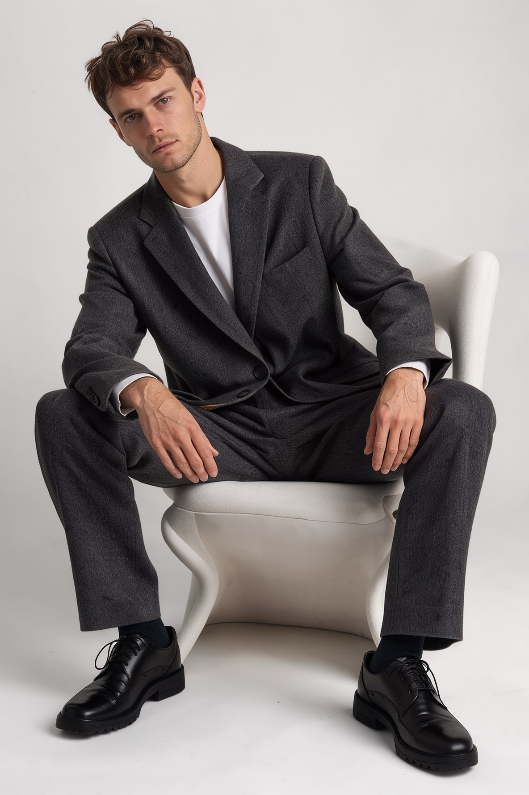

# Brennglas

<p align="center"><b>
<a href="#setup">Setup</a> &nbsp;·&nbsp;
<a href="#start">Start</a> &nbsp;·&nbsp;
<a href="#requirements">Requirements</a> &nbsp;·&nbsp;
<a href="#model-files">Model files</a> &nbsp;·&nbsp;
<a href="#claude-as-your-director">Claude as your director</a> &nbsp;·&nbsp;
<a href="#models">Models and licenses</a> &nbsp;·&nbsp;
<a href="#sample-images">Sample images</a>
</b></p>

**Ask Claude for a spot. Get a cut clip, rendered on your own GPU.**

[](screenshots/mara.mp4)

*A day with Mara, 23 seconds, the same woman in five shots. Claude put the saved character into five new scenes with FLUX 3 Klein, checked faces and hands, animated the shots with LTX-2.5 and cut them with fades. No training, no face swap. Click for the MP4 with sound.*

[](screenshots/spot.mp4)

*A 16 second spot for a made up ceramics brand, from a short request. Three shots of the blue vase, cut with fades, logo and end card. Click for the MP4 with sound.*

Brennglas is a local web app for open image and video models.
ComfyUI renders everything on your own GPU.
One user, one machine, no login.
It is also an MCP server, so Claude can direct whole clips for you, see [Claude as your director](#claude-as-your-director).

<table>
<tr>
<td width="50%"><br><b>Edit with reference images.</b> Before/after slider and an edit chain you can step back through.</td>
<td width="50%"><br><b>Image to video with sound.</b> Camera presets and looks for LTX-2.5, every shot in the same gallery.</td>
</tr>
</table>

## What it does

- Text to image and image editing with up to 16 input images.
- Consistent characters and products: save a person or product once (portrait and a reference sheet with four views), then put up to three of them into any new scene.
- Text to video, image to video, and first plus last frame video, with sound.
- Camera presets and looks for video, and real camera paths with Wan Fun Camera.
- Upscaling of images to 8K and of render sequences to UHD 4K.
- A prompt assistant that turns short notes (in any language) into a good English prompt.
- Live preview while rendering, before/after slider, remix, edit chains, queue.
- A gallery with search, favorites and series.
- Claude can drive Brennglas as a director over MCP: plan shots, render, check details, cut the clip.
- Interface in English and German.

## Claude as your director

Brennglas comes with an MCP server. With it, Claude works your GPU like a small film crew.
Ask for a spot, and Claude:

1. plans a shot list with subject, camera move and look for each shot,
2. renders a start image per shot and checks hands, faces and products at full resolution,
3. animates each shot with LTX-2.5 or Wan Fun Camera,
4. looks at every result and redoes weak shots,
5. cuts the clip with one music track, your logo and an end card.

Every image and video shows up live in your gallery, so you can watch and step in.

Try something like this:

> Make a 15 second spot for our ceramics brand HALDE. Three shots of the blue vase in a calm Japandi living room, golden hour light, our logo in the corner and an end card.

The ceramics spot at the top of this page came from this request.

When the same person or product appears in several shots, Claude saves it as a character first and renders every start image from it, so the face stays the same. The Mara spot at the top was made that way.

The tools Claude gets:

- `generate` starts an image or video job with any model and option.
- `wait` waits for a job and returns a preview.
- `inspect_image` shows a region of a result at full resolution.
- `figures` and `create_figure` list and save characters and products; `generate` puts them into new scenes.
- `last_frame` takes the last frame of a video as the start of the next shot.
- `concat` cuts shots into one clip with cuts or fades, music, logo and end card.
- `list_models`, `gallery` and `enhance_prompt` read the models, browse results and write prompts.

The server also hands Claude a short directing guide with the known limits of the video models and what helps.

### Connect

Brennglas must be running (`start.bat`), the MCP server talks to it.

**Claude Desktop app**

1. At the end, `install.bat` prints a ready block with the right paths for your computer. Copy it.
2. In Claude Desktop open Settings, Developer, **Edit Config**. This opens `claude_desktop_config.json`.
3. Paste the block. If other servers are already listed under `mcpServers`, add only the `"brennglas": { ... }` entry, separated by a comma.
4. Quit Claude Desktop completely, also from the tray icon next to the clock, and start it again.
5. The Brennglas tools now show up under the tools icon in the chat box. Ask for an image or a spot. Claude asks once per tool before it uses it.

Writing the block by hand? It looks like this. Replace `<brennglas folder>` with your path and write every backslash twice:

```json
{
  "mcpServers": {
    "brennglas": {
      "command": "<brennglas folder>\\app\\runtime\\node\\node.exe",
      "args": ["<brennglas folder>\\app\\mcp\\src\\index.ts"]
    }
  }
}
```

`command` is the portable Node.js that `install.bat` set up. If you installed Node.js 22.18 or newer yourself, `"node"` works too.
If the tools do not show up, Settings, Developer shows the server status and its log. Most often a path has single backslashes, or Brennglas is not running.

**Claude Code:** open the Brennglas folder. The file `.mcp.json` registers the server. Confirm it once. It needs Node.js 22.18 or newer in your `PATH`.

- **Other MCP clients** that start local (stdio) servers should work the same way, for example Codex CLI or LM Studio. They are not tested.
  The client must pass images from tool results to the model. Small local models handle single images well, whole clips less so.

Clients that only connect to servers on the internet cannot reach Brennglas. It only listens on your own computer.

## Sample images

The gallery starts with these eight sample images, all made with Brennglas. Remix any of them to see prompt and settings.

<table>
<tr>
<td></td>
<td></td>
<td></td>
<td></td>
</tr>
<tr>
<td></td>
<td></td>
<td></td>
<td></td>
</tr>
</table>

## Models

Each model has its own license. Brennglas shows it before you first use the model.
The table is a short summary, not legal advice. Read the license yourself.

| Model | Use | License | Commercial use |
|---|---|---|---|
| MiniMax H3 Image | image, edit | [MiniMax-H3-Image Community](https://huggingface.co/MiniMaxAI/MiniMax-H3-Image/blob/main/LICENSE) | Limited. Not licensed in the EU, UK, South Korea and USA. Above USD 1M yearly revenue only with permission. |
| Qwen-Image-2.1 Turbo | image, edit | [Qwen Research](https://huggingface.co/Qwen/Qwen-Image-2.1-Turbo) | No. Research and evaluation only. |
| FLUX 3 Image Klein | image, edit | [FLUX Kommunity](https://huggingface.co/black-forest-labs/flux-3-image-klein) | Below USD 5M yearly revenue, with content filters or output review. |
| Krea 2 Turbo | image | [Krea 2 Community](https://huggingface.co/krea/Krea-2-Turbo) | Below USD 1M yearly revenue, with content filters or an equivalent review. |
| Z-Image Turbo | image | [Apache 2.0](https://huggingface.co/Tongyi-MAI/Z-Image-Turbo) | Yes. |
| LTX-2.5 22B | video with sound | [LTX-2.x Community](https://github.com/Lightricks/LTX-2/blob/main/LICENSE-2_x) | Below USD 10M yearly revenue. |
| Wan 2.2 Fun Camera 14B | video with camera path | [Apache 2.0](https://huggingface.co/alibaba-pai/Wan2.2-Fun-A14B-Control-Camera) | Yes. |
| SeedVR2 7B | upscaling | [Apache 2.0](https://huggingface.co/ByteDance-Seed/SeedVR2-7B) | Yes. |
| Gemma 4 E2B, Qwen 3.5 9B | prompt assistant | [Apache 2.0](https://huggingface.co/Qwen/Qwen3.5-9B) | Yes. |

## Requirements

- Windows 10 or 11. Other systems may work with `pnpm dev`, but are not tested.
- An NVIDIA GPU. Tested on an RTX 3090 with 24 GB. Support for 16 GB cards is in the works.
- About 10 GB of free space for ComfyUI, plus the models you pick (5 to 50 GB each).
- `install.bat` sets up the rest: Node.js, the portable [ComfyUI](https://github.com/comfyanonymous/ComfyUI) (tested with 0.45), the models and, if you want, the custom nodes [VideoHelperSuite](https://github.com/Kosinkadink/ComfyUI-VideoHelperSuite) and [WAS Node Suite](https://github.com/WASasquatch/was-node-suite-comfyui) for upscaling render sequences.
- Optional: ffmpeg and ffprobe in your `PATH`. They cut clips, take the last frame of a video and write MP4 or ProRes from upscaled sequences.

## Model files

The easiest way is `install.bat`, see [Setup](#setup). To download by hand, put each file into the named folder under `ComfyUI\models`.
A file that several models share is needed only once. The links point to the same files the official ComfyUI templates use.

<!-- model-files:start -->
Gated on Hugging Face: [FLUX 3 Image Klein](https://huggingface.co/black-forest-labs/flux-3-image-klein-comfy), [LTX-2.5 22B](https://huggingface.co/Lightricks/LTX-2.5).
Log in, open the model page and accept the license once. Then their links work in your browser.

<details><summary>MiniMax H3 Image</summary>

| File | Folder |
|---|---|
| [minimax_h3_image_pruned_int8_convrot.safetensors](https://huggingface.co/Comfy-Org/MiniMax-H3-Image/resolve/main/diffusion_models/minimax_h3_image_pruned_int8_convrot.safetensors) | `diffusion_models` |
| [qwen3.5_9b_w4a8_gptq.safetensors](https://huggingface.co/Comfy-Org/Qwen3.5/resolve/main/text_encoders/qwen3.5_9b_w4a8_gptq.safetensors) | `text_encoders` |
| [qwen3vl_32b_minimax_h3_int8_convrot.safetensors](https://huggingface.co/Comfy-Org/MiniMax-H3/resolve/main/text_encoders/qwen3vl_32b_minimax_h3_int8_convrot.safetensors) | `text_encoders` |
| [minimax_h3_image_vae_fp16.safetensors](https://huggingface.co/Comfy-Org/MiniMax-H3-Image/resolve/main/vae/minimax_h3_image_vae_fp16.safetensors) | `vae` |

</details>

<details><summary>Krea 2 Turbo</summary>

| File | Folder |
|---|---|
| [krea2_turbo_fp8_scaled.safetensors](https://huggingface.co/Comfy-Org/Krea-2/resolve/main/diffusion_models/krea2_turbo_fp8_scaled.safetensors) | `diffusion_models` |
| [qwen3vl_4b_fp8_scaled.safetensors](https://huggingface.co/Comfy-Org/Krea-2/resolve/main/text_encoders/qwen3vl_4b_fp8_scaled.safetensors) | `text_encoders` |
| [qwen_image_vae.safetensors](https://huggingface.co/Comfy-Org/Krea-2/resolve/main/vae/qwen_image_vae.safetensors) | `vae` |

</details>

<details><summary>Qwen-Image-2.1 Turbo</summary>

| File | Folder |
|---|---|
| [qwen_image_2.1_turbo_int8_convrot.safetensors](https://huggingface.co/Comfy-Org/Qwen-Image-2.1/resolve/main/diffusion_models/qwen_image_2.1_turbo_int8_convrot.safetensors) | `diffusion_models` |
| [qwen3.5_9b_qwen_image_2.1_pe_i2i.int8_convrot.safetensors](https://huggingface.co/Comfy-Org/Qwen-Image-2.1/resolve/main/text_encoders/qwen3.5_9b_qwen_image_2.1_pe_i2i.int8_convrot.safetensors) | `text_encoders` |
| [qwen3.5_9b_qwen_image_2.1_pe_t2i.int8_convrot.safetensors](https://huggingface.co/Comfy-Org/Qwen-Image-2.1/resolve/main/text_encoders/qwen3.5_9b_qwen_image_2.1_pe_t2i.int8_convrot.safetensors) | `text_encoders` |
| [qwen3vl_8b_int8_convrot.safetensors](https://huggingface.co/Comfy-Org/Qwen-Image-2.1/resolve/main/text_encoders/qwen3vl_8b_int8_convrot.safetensors) | `text_encoders` |
| [qwen_image_2.1_vae_bf16.safetensors](https://huggingface.co/Comfy-Org/Qwen-Image-2.1/resolve/main/vae/qwen_image_2.1_vae_bf16.safetensors) | `vae` |

</details>

<details><summary>Z-Image Turbo</summary>

| File | Folder |
|---|---|
| [z_image_turbo_int8_convrot.safetensors](https://huggingface.co/Comfy-Org/z_image_turbo/resolve/main/split_files/diffusion_models/z_image_turbo_int8_convrot.safetensors) | `diffusion_models` |
| [qwen_3_4b_fp8_mixed.safetensors](https://huggingface.co/Comfy-Org/z_image_turbo/resolve/main/split_files/text_encoders/qwen_3_4b_fp8_mixed.safetensors) | `text_encoders` |
| [ae.safetensors](https://huggingface.co/Comfy-Org/z_image_turbo/resolve/main/split_files/vae/ae.safetensors) | `vae` |

</details>

<details><summary>FLUX 3 Image Klein</summary>

| File | Folder |
|---|---|
| [flux3-image-klein-int8-convrot.safetensors](https://huggingface.co/black-forest-labs/flux-3-image-klein-comfy/resolve/main/diffusion_models/flux3-image-klein-int8-convrot.safetensors) | `diffusion_models` |
| [qwen3.5_9b_flux3_prompt_upsampler_w4a8.safetensors](https://huggingface.co/black-forest-labs/flux-3-image-klein-comfy/resolve/main/text_encoders/qwen3.5_9b_flux3_prompt_upsampler_w4a8.safetensors) | `text_encoders` |
| [qwen3vl_4b_int8_convrot.safetensors](https://huggingface.co/black-forest-labs/flux-3-image-klein-comfy/resolve/main/text_encoders/qwen3vl_4b_int8_convrot.safetensors) | `text_encoders` |
| [flux2-vae.safetensors](https://huggingface.co/Comfy-Org/flux2-dev/resolve/main/split_files/vae/flux2-vae.safetensors) | `vae` |

</details>

<details><summary>LTX-2.5 22B</summary>

| File | Folder |
|---|---|
| [ltx-2.5-22b-distilled-transformer-comfy-int8-convrot.safetensors](https://huggingface.co/Lightricks/LTX-2.5/resolve/main/diffusion_models/ltx-2.5-22b-distilled-transformer-comfy-int8-convrot.safetensors) | `diffusion_models` |
| [ltx-2.5-latent-spatial-upscaler-x2-bf16-1.0.safetensors](https://huggingface.co/Lightricks/LTX-2.5/resolve/main/latent_upscale_models/ltx-2.5-latent-spatial-upscaler-x2-bf16-1.0.safetensors) | `latent_upscale_models` |
| [gemma4_e2b_it_int8_convrot.safetensors](https://huggingface.co/Comfy-Org/gemma-4/resolve/main/text_encoders/gemma4_e2b_it_int8_convrot.safetensors) | `text_encoders` |
| [gemma4-12b-with-proj-ltx-2.5-comfy-int8-convrot.safetensors](https://huggingface.co/Lightricks/LTX-2.5/resolve/main/text_encoders/gemma4-12b-with-proj-ltx-2.5-comfy-int8-convrot.safetensors) | `text_encoders` |
| [ltx-2.5-audio-vae-bf16.safetensors](https://huggingface.co/Lightricks/LTX-2.5/resolve/main/vae/ltx-2.5-audio-vae-bf16.safetensors) | `vae` |
| [ltx-2.5-video-vae-bf16.safetensors](https://huggingface.co/Lightricks/LTX-2.5/resolve/main/vae/ltx-2.5-video-vae-bf16.safetensors) | `vae` |

</details>

<details><summary>Wan 2.2 Fun Camera 14B</summary>

| File | Folder |
|---|---|
| [wan2.2_fun_camera_high_noise_14B_fp8_scaled.safetensors](https://huggingface.co/Comfy-Org/Wan_2.2_ComfyUI_Repackaged/resolve/main/split_files/diffusion_models/wan2.2_fun_camera_high_noise_14B_fp8_scaled.safetensors) | `diffusion_models` |
| [wan2.2_fun_camera_low_noise_14B_fp8_scaled.safetensors](https://huggingface.co/Comfy-Org/Wan_2.2_ComfyUI_Repackaged/resolve/main/split_files/diffusion_models/wan2.2_fun_camera_low_noise_14B_fp8_scaled.safetensors) | `diffusion_models` |
| [wan2.2_i2v_lightx2v_4steps_lora_v1_high_noise.safetensors](https://huggingface.co/Comfy-Org/Wan_2.2_ComfyUI_Repackaged/resolve/main/split_files/loras/wan2.2_i2v_lightx2v_4steps_lora_v1_high_noise.safetensors) | `loras` |
| [wan2.2_i2v_lightx2v_4steps_lora_v1_low_noise.safetensors](https://huggingface.co/Comfy-Org/Wan_2.2_ComfyUI_Repackaged/resolve/main/split_files/loras/wan2.2_i2v_lightx2v_4steps_lora_v1_low_noise.safetensors) | `loras` |
| [qwen3.5_9b_w4a8_gptq.safetensors](https://huggingface.co/Comfy-Org/Qwen3.5/resolve/main/text_encoders/qwen3.5_9b_w4a8_gptq.safetensors) | `text_encoders` |
| [umt5_xxl_fp8_e4m3fn_scaled.safetensors](https://huggingface.co/Comfy-Org/Wan_2.1_ComfyUI_repackaged/resolve/main/split_files/text_encoders/umt5_xxl_fp8_e4m3fn_scaled.safetensors) | `text_encoders` |
| [wan_2.1_vae.safetensors](https://huggingface.co/Comfy-Org/Wan_2.2_ComfyUI_Repackaged/resolve/main/split_files/vae/wan_2.1_vae.safetensors) | `vae` |

</details>

<details><summary>SeedVR2 7B</summary>

| File | Folder |
|---|---|
| [seedvr2_7b_int8_convrot.safetensors](https://huggingface.co/Comfy-Org/SeedVR2/resolve/main/diffusion_models/seedvr2_7b_int8_convrot.safetensors) | `diffusion_models` |
| [seedvr2_ema_vae_fp16.safetensors](https://huggingface.co/Comfy-Org/SeedVR2/resolve/main/vae/seedvr2_ema_vae_fp16.safetensors) | `vae` |

</details>

<details><summary>Prompt assistant (Gemma 4 E2B, Qwen 3.5 9B)</summary>

| File | Folder |
|---|---|
| [gemma4_e2b_it_int8_convrot.safetensors](https://huggingface.co/Comfy-Org/gemma-4/resolve/main/text_encoders/gemma4_e2b_it_int8_convrot.safetensors) | `text_encoders` |
| [qwen3.5_9b_w4a8_gptq.safetensors](https://huggingface.co/Comfy-Org/Qwen3.5/resolve/main/text_encoders/qwen3.5_9b_w4a8_gptq.safetensors) | `text_encoders` |

</details>
<!-- model-files:end -->

## Setup

1. Get Brennglas: `git clone https://github.com/m-w-marker/brennglas.git`, or **Code → Download ZIP** on this page and unpack it.
   Put it on a drive with free space, not into your user folder. The gallery grows inside `app\data`, and ComfyUI with its models goes next to it.
2. Double click `install.bat`. It walks you through everything:
   - gets a portable Node.js just for Brennglas, if yours is missing or too old (nothing is installed system wide),
   - uses your portable ComfyUI or downloads it (about 2 GB), and offers an update if yours is older than 0.45,
   - asks whether to add the two custom nodes for upscaling render sequences (needs Git),
   - installs Brennglas itself,
   - lists every model with download size and license and downloads the ones you pick.
3. Double click `start.bat`.

Run `install.bat` again any time to add models. Interrupted downloads continue where they stopped.
For the two gated models it opens the Hugging Face page and asks once for a read token.

**Updating:** run `git pull` in the Brennglas folder (or unpack the new ZIP over the old folder), then run `install.bat` once.
Your gallery, characters and settings in `app\data` and `app\.env` stay. The database is upgraded on the first start and backed up before.

<details><summary>Manual setup without install.bat</summary>

Run these lines in a Command Prompt (cmd), not in PowerShell. You need Node.js 22.18 or newer.

```
cd brennglas\app
corepack pnpm install
copy .env.example .env
```

Open `app\.env`, remove the `#` in front of `COMFY_DIR` and set it to your portable ComfyUI folder (the one with `python_embeded`). Write the path without quotes.
Then get the model files from [Model files](#model-files).

</details>

## Start

Double click `start.bat`. It starts ComfyUI, Brennglas and your browser.

Or start ComfyUI yourself, then run `pnpm dev` in `app` and open http://127.0.0.1:5173.

On the first start the gallery holds eight sample images, all made with Brennglas.
Click one and press Remix to see its prompt and settings.
To try an edit, open the living room, press Keep editing and add the blue vase as a reference.

## Ideas, and your opinion

- **A light version.** Small and easy to host, without ComfyUI and without a strong GPU.
  All models would run through cloud APIs such as fal or Replicate, and you pay the provider per image.
  Would you use this? Please open an issue and tell me.
- **16 GB graphics cards.** In the works: measured VRAM needs per model, and lighter model variants where 16 GB is not enough.
- **Remote access**, for example over Tailscale, is not a feature yet. If you need it, open an issue.

## License

Brennglas is licensed under [AGPL-3.0-only](LICENSE).
You can use it freely. If you share a changed version or run it as a web service for others, you must publish your code.
The models have their own licenses, see above.
